  

  Construo produtos do começo ao fim: da interface ao banco de dados. 
  Tecnólogo em Sistemas para Internet (IFMA), com foco em <b>React</b>, <b>TypeScript</b> e <b>Node.js</b>.

  
  
  

## Em destaque

<table>
  <tr>
    <td></td>
    <td></td>
    <td></td>
  </tr>
</table>

## Mais projetos

| Projeto | O que é | Stack |
| --- | --- | --- |
| [**MoonDeck**](https://github.com/isaac-const/Moondeck) | Deck de ações para as teclas que você quase não usa (Home, PgUp, F13 a F24, numpad), organizado por modos. | Tauri 2 · React 19 |
| [**Arcahub**](https://github.com/isaac-const/Arcahub) | Central de comando para desenvolvedores: projetos, tarefas e Git num lugar só. | Electron · React · Vite |
| [**Upple**](https://github.com/isaac-const/upple) | Aplicativo para divulgação de projetos open source. | Expo · React Native · Supabase |
| [**RecipeNow**](https://github.com/isaac-const/recipenow) | Aplicativo de receitas com busca, filtros e favoritos. | Expo · React Native |

## Stack

  <b>Linguagens</b> 
  

  <b>Front-end</b> 
  

  <b>Mobile e desktop</b> (React Native + Expo, Electron, Tauri) 
  

  <b>Back-end e dados</b> 
  

  <b>Ferramentas</b> 
  

## Contato

Aberto a oportunidades como desenvolvedor full stack.

  
  
  

