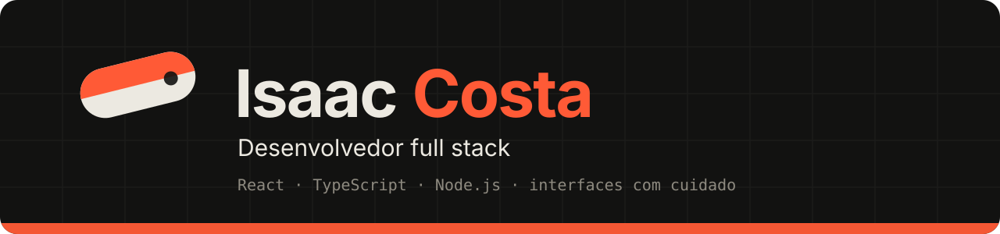

  <picture>
    <source media="(prefers-color-scheme: dark)" srcset="assets/banner-dark.svg">
    <source media="(prefers-color-scheme: light)" srcset="assets/banner-light.svg">
    
  </picture>

Desenvolvedor full stack, tecnólogo em Sistemas para Internet pelo IFMA. Gosto de interface limpa, que se sente bem de usar, e de back-end que não dá susto. Também desenho no Figma antes de codar.

  
  
  

## Projetos

| Projeto | O que é |
| --- | --- |
| [**KaniBox**](https://github.com/isaac-const/kanibox) | Catálogo de ferramentas, apps e jogos que eu uso e recomendo, em português e inglês. [Site](https://isaac-const.github.io/kanibox/) |
| [**MoonDeck**](https://github.com/isaac-const/Moondeck) | Deck de ações para as teclas que você quase não usa (Home, PgUp, F13 a F24, numpad), organizado por modos. Tauri 2 e React 19. |
| [**Upple**](https://github.com/isaac-const/upple) | Aplicativo para divulgação de projetos open source. |
| [**Arcahub**](https://github.com/isaac-const/Arcahub) | Projeto em TypeScript. |
| [**RecipeNow**](https://github.com/isaac-const/recipenow) | Aplicativo de receitas, em TypeScript. |

## Stack

**Front-end:** React, TypeScript, JavaScript, TailwindCSS, HTML, CSS, Figma
**Back-end:** Node.js, Express, AdonisJS, APIs REST, PHP
**Dados:** PostgreSQL, MySQL, Supabase
**Dia a dia:** Git, GitHub, Linux, Arduino

## Agora

- Trabalhando como desenvolvedor full stack.
- Ideias de desktop e mobile em planejamento: **Grimo Notes** (notas) e **Kita Finances** (finanças).
- Inglês avançado, espanhol intermediário.

Feito à mão. Sem contador de visitas nem gráficos de commits: o código fala melhor.
